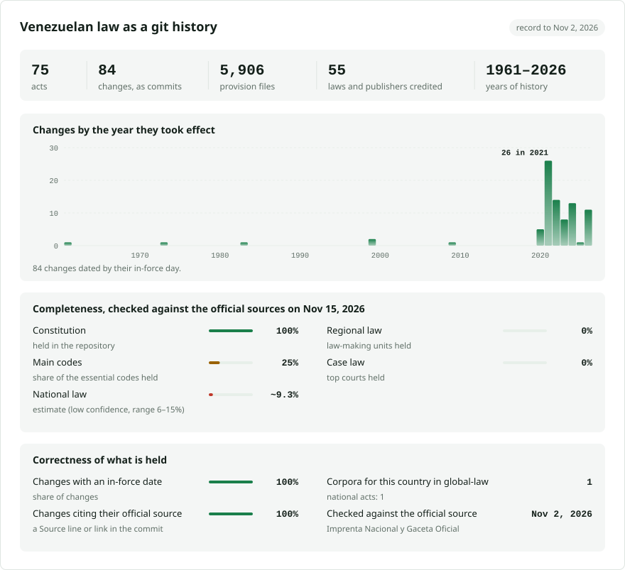

# Venezuela: law history in git

[Español](README.md) · **English**

<picture>
<source media="(prefers-color-scheme: dark)" srcset="data/effort-dark.svg">

</picture>

The national law of Venezuela as a git history: one file per provision, one commit per act on the day it took effect, and the act that made each change as the commit's author. `git blame` names the act behind every paragraph; `git log` lists every change to an article; picking a date gives the text in force that day.

Part of [lexifina/global-law](https://github.com/lexifina/global-law), one git history for every country's law: this is Venezuela's national law, which global-law reads at `venezuela/national/acts/`.

**What is in it now:** the Constitution of 1999 with its Enmienda N° 1 of 2009; the Constitution of 1961 with its two enmiendas, up to its repeal in 1999; and 4 organic codes (procedural criminal, tax, penitentiary and military justice) and 69 laws, among them the Ley Orgánica del Tribunal Supremo de Justicia and the Ley Orgánica de Hidrocarburos, each from a full printing in the Gaceta Oficial of 2020 to 2026. Together they have 84 versions. [`data/versions.json`](data/versions.json) lists every act with the day each version took effect; [`data/laws.csv`](data/laws.csv) lists every act the record names (89, among them earlier texts that are not here), with its dates.

Each act is a folder named after it (`constitucion/`, `ley-organica-de-hidrocarburos/`), with one file per article and per transitory or final provision: `constitucion/art-230.md` is art. 230 of the Constitution, on the presidential term. Each folder's `README.md` lists its provisions, and its `titulos.md` its headings.

The text is in Spanish, as the Gaceta Oficial prints it: from born-digital gazettes, only the characters the page actually prints, with no OCR ([`tools/gazette_text.py`](tools/gazette_text.py)). Venezuela has no official consolidated database with dated versions, and its gazette is indexed online only from 2010, mostly as image scans.

## Questions as git commands

| Question | Command |
| --- | --- |
| Every change to art. 230 of the Constitution | `git log -p --word-diff -- constitucion/art-230.md` |
| Which act wrote each paragraph of art. 230? | `git blame constitucion/art-230.md` |
| Every version of the Constitution, with the day each took effect | `git log --format="%h %(trailers:key=In-force,valueonly,separator=) %an" -- constitucion ":^constitucion/README.md"` |
| Art. 230 as in force on 1 January 2005 (one immediate re-election only) | `python tools/en_vigor_el.py 2005-01-01 constitucion 230` |

**Outside git**, we also host this record publicly, for free:

- **[Ask Claude about Venezuelan law](https://global-law.lexifina.com/v1/try_claude?country=venezuela)**: opens Claude with a first question ready.
- **[Ask ChatGPT](https://global-law.lexifina.com/v1/try_chatgpt?country=venezuela)**: the same question in ChatGPT.
- **[Search Venezuelan law on our site](https://lexifina.com/law?country=venezuela&q=vacaciones+anuales)**: a search for "vacaciones anuales", with each provision's text and its versions, no account needed.
- **[Developer REST API](https://global-law.lexifina.com/v1/search_law?query=vacaciones+anuales&jurisdiction=venezuela)**: the same search as JSON, with no key. See the [documentation here](https://lexifina.com/api/global-law).

Both assistants read the record through the free Global law connector (MCP, `https://global-law.lexifina.com/mcp`); the first time, the chat gives you the link that adds it. Ask in Spanish or in English.

**Host it yourself easily.** All it takes is git and Python, and the tools run on your machine:

```sh
git clone --depth 1 https://github.com/lexifina/global-law && cd global-law
python3 tools/countries.py add venezuela/national/acts
python3 tools/law.py show 2026-01-01 venezuela/national/acts/constitucion/art-230.md
```

Opened in Claude Code, Cursor, VS Code or Codex, the clone also starts a local MCP server with the same tools ([MCP.md](https://github.com/lexifina/global-law/blob/main/MCP.md)).

## Dates

Each commit is dated at noon, America/Caracas, on the day the change took effect, and carries it in its `In-force:` trailer, beside `Enacted:` and `Published:`:

- an act binds from its publication in the Gaceta Oficial, or from the later day it sets itself (Código Civil art. 1); where it sets a term (thirty days for the Código Orgánico Tributario, sixty for the IVA law, 120 for the Ley de la Actividad Aseguradora), the day is counted by hand, with the reasoning in [`REPRODUCE.md`](REPRODUCE.md);
- the Constitution of 1999 took effect on its publication, 30 December 1999, and Enmienda N° 1, approved by referendum on 15 February 2009, on its publication on 19 February 2009;
- git cannot store dates before 1970, so the commit of the 1961 Constitution is dated 1970-01-01, with the real day, 1961-01-23, in `In-force:`. Ask for a date with `tools/en_vigor_el.py`, not `git log --before`.

Each change is credited to the act that made it, at an address that cannot exist (`enmienda-1-2009@gacetaoficial.invalid`), so `git blame` and `git log --author` name acts; the committer is Lexifina. 44 codes and laws start as enacted and are credited to themselves; the other 29 start from a later texto único, credited to the publisher, the Imprenta Nacional y Gaceta Oficial, as the "oldest version available", naming the reform that ordered it.

## How it is checked

- `tools/check_repo.py` reads every version back from git on the day it took effect and on the day before; both must match the corpus, whose sha256 is in `data/corpus.sha256`: 84 versions of 75 acts, 0 mismatches ([`REPRODUCE.md`](REPRODUCE.md)).
- For each code and law, the words in its files equal the words printed in its part of the gazette, and every article number occurs once; each repair those checks led to, and each line of the Constitution filled from the Asamblea Nacional's text where the INE copy lacks it, is listed in `REPRODUCE.md`.
- The same corpus gives the same commit hashes (`tools/build.py`); `REPRODUCE.md` records that no second build has been compared yet.
- History is append-only (`tools/append.py`): no merge commits on `main`, no commit dates that go backwards, nothing dated in the future, and every commit's trailers parse.
- [vulnerabilities/](vulnerabilities/README.en.md): possible drafting mistakes in this law, found by global-law's detectors and checked by hand. Not run yet.

## What it does not show

- **Most national law.** The Código Civil (1982), the Código Penal (2005), the Código de Comercio (1955), the labour law (LOTTT, 2012) and most laws before about 2018 exist officially only as image scans, and no OCR is used, so they are not here.
- **Earlier versions of the codes and laws.** Each history starts at its 2020-2026 printing; earlier texts (the COPP of 1998 to 2012, the LOTSJ of 2010 and others) are scans or not online. From 29 January to 30 March 2026, arts. 51 and 55 of the Ley Orgánica de Hidrocarburos read only that the source gives no text, as their 2006 wording survives only as a scan.
- **The Constitution as first printed** in G.O. 36.860 (1999): no machine-readable copy was found, so the 1999 version has the wording of the corrected reprint. The Exposición de Motivos is not part of the text.
- **Arts. 191 and 192 of the Constitution of 1961**, missing from the only source.
- **Case law, decrees and regulations.** Rulings of the Sala Constitucional change no words and are not recorded.

## Sources

| Source | Kind | Past versions | Notes |
| --- | --- | --- | --- |
| [Gaceta Oficial](http://www.gacetaoficial.gob.ve) (Servicio Autónomo Imprenta Nacional y Gaceta Oficial) | Official gazette | gazettes from 2010 only, as PDFs | Every code and law here, from born-digital gazettes of 2020-2026 |
| [Instituto Nacional de Estadística](https://ine.gob.ve) | Copy of G.O. 5.908 Ext. (2009) with a text layer | n/a | The Constitution of 1999, the latest full official printing |
| [Asamblea Nacional](https://www.asambleanacional.gob.ve) | Legislature | no | Its 1999 text of the Constitution, to fill the lines missing from the INE copy |
| [Tribunal Supremo de Justicia](https://www.tsj.gob.ve), through the [Internet Archive](https://web.archive.org) | Court; its transcription of the 1961 Constitution | the text as reprinted after Enmienda N° 2 (1983), with both enmiendas | A 2011 capture |

## Licence

See [`LICENSE`](LICENSE). The legal texts are official acts of the Bolivarian Republic of Venezuela, published in the Gaceta Oficial; the Ley sobre el Derecho de Autor (1993, art. 11) is understood to exclude official acts from protection, a reading not checked against the gazette text. Lexifina's own contributions (the arrangement of the history, the commit messages, the tables and the tools) are CC0 1.0.

No AI model wrote, translated or corrected legal text, and none runs at build time. Claude Code running Claude Opus 5.5 wrote the scripts and selected metadata and parser boundaries; the legal text comes only from the official PDFs' text layer (see [`REPRODUCE.md`](REPRODUCE.md)).

## Visualisations

- [visualisations/](visualisations/README.en.md): charts drawn from this repository. Not drawn yet.

## More

From [lexifina/global-law](https://github.com/lexifina/global-law):

- [FEATURES.md](https://github.com/lexifina/global-law/blob/main/FEATURES.md): every feature, and what every corpus must support (`git blame`, `law.py`, the MCP tools)
- [FAQ.md](https://github.com/lexifina/global-law/blob/main/FAQ.md): questions and answers · [CONTRIBUTING.md](https://github.com/lexifina/global-law/blob/main/CONTRIBUTING.md): proposing changes · [MCP.md](https://github.com/lexifina/global-law/blob/main/MCP.md): the MCP server · [REPRODUCE.md](https://github.com/lexifina/global-law/blob/main/REPRODUCE.md): how it was built · [CHANGELOG.md](https://github.com/lexifina/global-law/blob/main/CHANGELOG.md)
- [FRESHNESS.md](https://github.com/lexifina/global-law/blob/main/FRESHNESS.md): how current each corpus is · [Monitoring](https://github.com/lexifina/global-law/tree/main/monitoring): whether updates are running · [WATCHING.md](https://github.com/lexifina/global-law/blob/main/WATCHING.md): how each official source is watched for changes
- [performance/](https://github.com/lexifina/global-law/tree/main/performance): how fast the tools are, measured
- [visualisations/](https://github.com/lexifina/global-law/tree/main/visualisations): charts and bridges across the world's law
- [Vulnerabilities](https://github.com/lexifina/global-law/tree/main/vulnerabilities): mistakes in legislation as published
