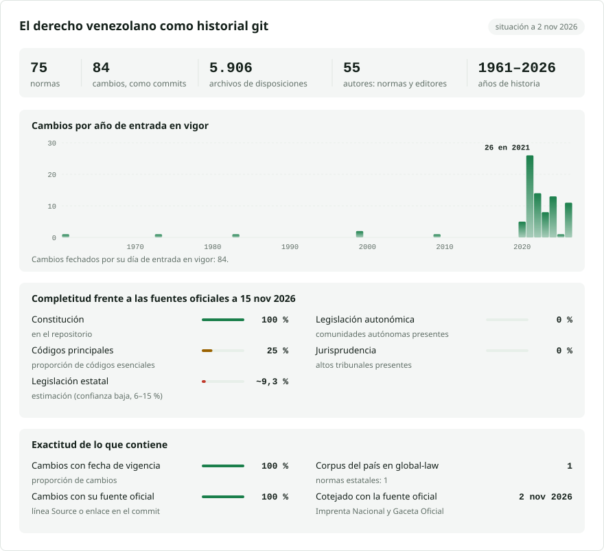

# Venezuela: historia del derecho en git

**Español** · [English](README.en.md)

<picture>
<source media="(prefers-color-scheme: dark)" srcset="data/es/effort-dark.svg">

</picture>

El derecho nacional de Venezuela como historial de git: un archivo por disposición, un commit por acto, fechado el día de su entrada en vigencia, y el acto que hizo cada cambio como autor del commit. `git blame` nombra el acto de cada párrafo; `git log` enumera cada cambio de un artículo; al elegir una fecha se obtiene el texto vigente ese día.

Forma parte de [lexifina/global-law](https://github.com/lexifina/global-law), un único historial de git para el derecho de todos los países: este es el derecho nacional de Venezuela, que global-law lee en `venezuela/national/acts/`.

**Qué contiene ahora:** la Constitución de 1999 con su Enmienda N° 1 de 2009 y la de 1961; 8 códigos, entre ellos el Código Civil (1982), el Código Penal (2000 y 2005), el Código de Comercio (1955), el Código de Procedimiento Civil (1990), el Código Orgánico Procesal Penal; 123 leyes y decretos-ley; y 3 decretos, 0 resoluciones, 0 providencias y 0 otros actos, sobre todo de FAOLEX. Véase [`STRUCTURE.md`](STRUCTURE.md).

Cada acto es una carpeta según su tipo y año (`codigos/codigo-civil/`, `leyes/2026/6978-ley-organica-de-hidrocarburos/`, `decretos/<año>/...`; véase [`STRUCTURE.md`](STRUCTURE.md)), con un archivo por artículo: `constitucion/art-230.md` es el art. 230 de la Constitución, sobre el período presidencial. El `README.md` de cada carpeta enumera sus disposiciones, y su `titulos.md`, sus encabezados.

El texto está en español. Las leyes de 2020-2026 proceden de gacetas nativas digitales, solo los caracteres que la página imprime realmente ([`tools/gazette_text.py`](tools/gazette_text.py)); los códigos y las leyes anteriores, de copias secundarias (FAOLEX, WIPO Lex) con su propia capa de texto, marcadas `Source-status: secondary copy` (y `Text-source: publisher OCR` cuando esa capa la hizo el editor por OCR). Aquí no se usa OCR.

## Preguntas como comandos de git

| Pregunta | Comando |
| --- | --- |
| Cada cambio del art. 230 de la Constitución | `git log -p --word-diff -- constitucion/art-230.md` |
| ¿Qué acto escribió cada párrafo del art. 230? | `git blame constitucion/art-230.md` |
| Cada versión de la Constitución, con el día en que entró en vigencia cada una | `git log --format="%h %(trailers:key=In-force,valueonly,separator=) %an" -- constitucion ":^constitucion/README.md"` |
| El art. 230 vigente el 1 de enero de 2005 (una sola reelección inmediata) | `python tools/en_vigor_el.py 2005-01-01 constitucion 230` |

**Fuera de git**, también alojamos este registro de forma pública y gratuita:

- **[Pregunte a Claude sobre el derecho venezolano](https://global-law.lexifina.com/v1/try_claude?country=venezuela)**: abre Claude con una primera pregunta ya preparada.
- **[Pregunte a ChatGPT](https://global-law.lexifina.com/v1/try_chatgpt?country=venezuela)**: la misma pregunta en ChatGPT.
- **[Busque en el derecho venezolano en nuestro sitio](https://lexifina.com/law?country=venezuela&q=vacaciones+anuales)**: una búsqueda de "vacaciones anuales", con el texto de cada disposición y sus versiones, sin necesidad de cuenta.
- **[API REST para desarrolladores](https://global-law.lexifina.com/v1/search_law?query=vacaciones+anuales&jurisdiction=venezuela)**: la misma búsqueda en JSON, sin clave. Consulte la [documentación aquí](https://lexifina.com/api/global-law).

Ambos asistentes leen el registro mediante el conector gratuito Global law (MCP, `https://global-law.lexifina.com/mcp`); la primera vez, el chat le da el enlace para añadirlo. Pregunte en español o en inglés.

**Alójelo usted mismo fácilmente.** Solo hacen falta git y Python, y las herramientas se ejecutan en su propio equipo:

```sh
git clone --depth 1 https://github.com/lexifina/global-law && cd global-law
python3 tools/countries.py add venezuela/national/acts
python3 tools/law.py show 2026-01-01 venezuela/national/acts/constitucion/art-230.md
```

Abierto en Claude Code, Cursor, VS Code o Codex, el clon también inicia un servidor MCP local con las mismas herramientas ([MCP.md](https://github.com/lexifina/global-law/blob/main/MCP.md)).

## Fechas

Cada commit está fechado al mediodía, hora de America/Caracas, del día en que el cambio entró en vigencia, y lo lleva en su trailer `In-force:`, junto a `Enacted:` y `Published:`:

- un acto es obligatorio desde su publicación en la Gaceta Oficial, o desde la fecha posterior que él mismo fije (Código Civil, art. 1); cuando fija un plazo (treinta días para el Código Orgánico Tributario, sesenta para la ley del IVA, 120 para la Ley de la Actividad Aseguradora), el día se cuenta a mano, con el razonamiento en [`REPRODUCE.md`](REPRODUCE.md);
- la Constitución de 1999 entró en vigencia con su publicación, el 30 de diciembre de 1999, y la Enmienda N° 1, aprobada por referendo el 15 de febrero de 2009, con su publicación el 19 de febrero de 2009;
- git no puede almacenar fechas anteriores a 1970, por lo que el commit de la Constitución de 1961 lleva la fecha 1970-01-01, con el día real, 1961-01-23, en `In-force:`. Para consultar una fecha use `tools/en_vigor_el.py`, no `git log --before`.

Cada cambio se atribuye al acto que lo hizo, con una dirección que no puede existir (`enmienda-1-2009@gacetaoficial.invalid`), de modo que `git blame` y `git log --author` nombran actos; el committer es Lexifina. 44 códigos y leyes empiezan tal como se sancionaron y se atribuyen a sí mismos; los otros 29 parten de un texto único posterior, atribuido al editor, la Imprenta Nacional y Gaceta Oficial, como la "oldest version available" (la versión más antigua disponible), con el nombre de la reforma que lo ordenó.

## Cómo se comprueba

- `tools/check_repo.py` vuelve a leer desde git cada versión el día en que entró en vigencia y el día anterior; ambas deben coincidir con el corpus, cuyo sha256 está en `data/corpus.sha256`: 84 versiones de 75 actos, 0 discrepancias ([`REPRODUCE.md`](REPRODUCE.md)).
- En cada código y ley, las palabras de sus archivos son iguales a las palabras impresas en su parte de la gaceta, y cada número de artículo aparece una sola vez; cada corrección a la que llevaron esas comprobaciones, y cada línea de la Constitución completada con el texto de la Asamblea Nacional donde falta en la copia del INE, se enumeran en `REPRODUCE.md`.
- El mismo corpus da los mismos hashes de commit (`tools/build.py`); `REPRODUCE.md` deja constancia de que todavía no se ha comparado una segunda construcción.
- El historial solo crece por adición (`tools/append.py`; los textos anteriores añadidos después llevan su propia fecha de vigencia, anterior a la del commit que los precede): no hay commits de fusión (merge) en `main`, ni nada con fecha futura, y los trailers de todos los commits se pueden analizar.
- [vulnerabilities/](vulnerabilities/): posibles errores de redacción en este derecho, hallados por los detectores de global-law y revisados a mano. Aún no se ha ejecutado.

## Lo que no muestra

- **Parte del derecho nacional.** Los actos cuya única copia es una imagen escaneada sin capa de texto, y los que no tienen un día de publicación fiable, no están aquí. Los servidores de la Gaceta Oficial y del Tribunal Supremo de Justicia no responden desde aquí, por lo que no se han podido usar sus copias.
- **Las versiones anteriores de los códigos y leyes.** Cada historia empieza en su publicación de 2020-2026; los textos anteriores (el COPP de 1998 a 2012, la LOTSJ de 2010 y otros) son escaneos o no están en línea. Del 29 de enero al 30 de marzo de 2026, los arts. 51 y 55 de la Ley Orgánica de Hidrocarburos dicen solo que la fuente no da ningún texto, ya que su redacción de 2006 se conserva solo como escaneo.
- **La Constitución tal como se publicó por primera vez** en la G.O. 36.860 (1999): no se encontró ninguna copia legible por máquina, por lo que la versión de 1999 tiene la redacción de la reimpresión corregida. La Exposición de Motivos no forma parte del texto.
- **Los arts. 191 y 192 de la Constitución de 1961**, que faltan en la única fuente.
- **La jurisprudencia.** Las sentencias de la Sala Constitucional no cambian ninguna palabra y no se registran.

## Fuentes

| Fuente | Tipo | Versiones anteriores | Notas |
| --- | --- | --- | --- |
| [Gaceta Oficial](http://www.gacetaoficial.gob.ve) (Servicio Autónomo Imprenta Nacional y Gaceta Oficial) | Diario oficial | gacetas solo desde 2010, en PDF | Todos los códigos y leyes de este registro, de gacetas nativas digitales de 2020-2026 |
| [Instituto Nacional de Estadística](https://ine.gob.ve) | Copia de la G.O. 5.908 Ext. (2009) con capa de texto | no aplica | La Constitución de 1999, la última publicación oficial íntegra |
| [Asamblea Nacional](https://www.asambleanacional.gob.ve) | Poder legislativo | no | Su texto de 1999 de la Constitución, para completar las líneas que faltan en la copia del INE |
| [Tribunal Supremo de Justicia](https://www.tsj.gob.ve), mediante el [Internet Archive](https://web.archive.org) | Tribunal; su transcripción de la Constitución de 1961 | el texto reimpreso después de la Enmienda N° 2 (1983), con ambas enmiendas | Una captura de 2011 |
| [FAOLEX](https://faolex.fao.org) (FAO) | Base de datos legislativa; copias de gacetas y textos | una por registro | Leyes, decretos y resoluciones anteriores, y el Código Penal de 2005; copia secundaria |
| [WIPO Lex](https://www.wipo.int/wipolex) (OMPI) | Base de datos legislativa | una por registro | Código Civil, Código de Comercio, Código de Procedimiento Civil, Código Penal de 2000; copia secundaria |

## Licencia

Véase [`LICENSE`](LICENSE). Los textos jurídicos son actos oficiales de la República Bolivariana de Venezuela, publicados en la Gaceta Oficial; se entiende que la Ley sobre el Derecho de Autor (1993, art. 11) excluye los actos oficiales de la protección, una interpretación no contrastada con el texto de la gaceta. Las aportaciones propias de Lexifina (la ordenación del historial, los mensajes de commit, las tablas y las herramientas) son CC0 1.0.

Ningún modelo de IA escribió, tradujo ni corrigió texto jurídico, y ninguno se ejecuta al construir el historial. Claude Code con Claude Opus 5.5 escribió los scripts y seleccionó los metadatos y los límites del analizador; el texto jurídico procede solo de la capa de texto de los PDF oficiales y de las copias secundarias y de las copias secundarias y de las copias secundarias y de las copias secundarias y de las copias secundarias y de las copias secundarias y de las copias secundarias y de las copias secundarias y de las copias secundarias y de las copias secundarias y de las copias secundarias y de las copias secundarias y de las copias secundarias (véase [`REPRODUCE.md`](REPRODUCE.md)).

Esta es una traducción de la versión inglesa ([README.en.md](README.en.md)); si difieren, prevalece la versión inglesa.

## Visualizaciones

- [visualisations/](visualisations/): gráficos hechos a partir de este repositorio. Aún no se han hecho.

## Más información

Del repositorio [lexifina/global-law](https://github.com/lexifina/global-law) (páginas en inglés):

- [FEATURES.md](https://github.com/lexifina/global-law/blob/main/FEATURES.md): todas las funciones y lo que cada corpus debe admitir (`git blame`, `law.py`, herramientas MCP)
- [FAQ.md](https://github.com/lexifina/global-law/blob/main/FAQ.md): preguntas y respuestas · [CONTRIBUTING.md](https://github.com/lexifina/global-law/blob/main/CONTRIBUTING.md): proponer cambios · [MCP.md](https://github.com/lexifina/global-law/blob/main/MCP.md): servidor MCP · [REPRODUCE.md](https://github.com/lexifina/global-law/blob/main/REPRODUCE.md): cómo se ha construido · [CHANGELOG.md](https://github.com/lexifina/global-law/blob/main/CHANGELOG.md)
- [FRESHNESS.md](https://github.com/lexifina/global-law/blob/main/FRESHNESS.md): lo actualizado que está cada corpus · [Supervisión](https://github.com/lexifina/global-law/tree/main/monitoring): si las actualizaciones funcionan · [WATCHING.md](https://github.com/lexifina/global-law/blob/main/WATCHING.md): cómo se vigila cada fuente oficial para detectar cambios
- [performance/](https://github.com/lexifina/global-law/tree/main/performance): la rapidez de las herramientas, medida
- [visualisations/](https://github.com/lexifina/global-law/tree/main/visualisations): gráficos y conexiones a través del derecho de todo el mundo
- [Vulnerabilidades](https://github.com/lexifina/global-law/tree/main/vulnerabilities): errores en las normas tal como se publicaron
